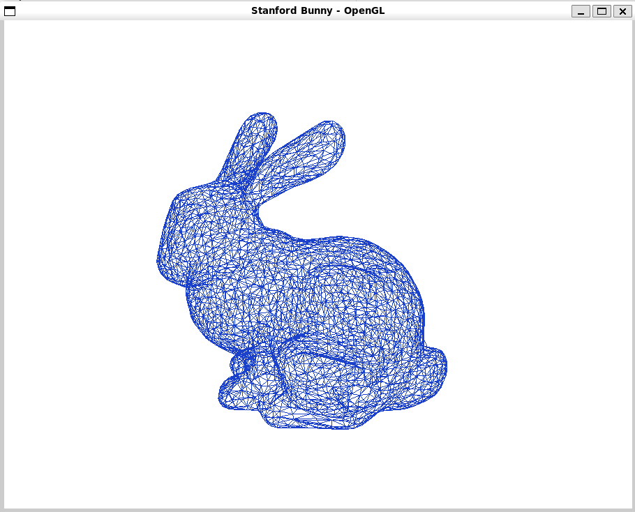

# Reconstrucción de superficies con Ball Pivoting: CPU y CUDA

**Computación Gráfica · UNSA · 2026-II**  
**Docente:** JUAN CARLOS GUTIERREZ CACERES  
**Integrantes:** IVAN ALEXANDER LOPEZ ZEGARRA, JESUS BRUNO CHANCAYAURI SONCCO y JOSE RODRIGO CARI ALMIRON

Este proyecto estudia la reconstrucción de una malla triangular a partir de puntos 3D. Incluye ejemplos de pivotamiento en 2D y 3D con OpenGL, visualización del Stanford Bunny, un Ball Pivoting sobre 2503 puntos y una versión multi-semilla para nubes mayores. También incluye una variante híbrida: la CPU mantiene el crecimiento de la malla y la GPU calcula las vecindades locales mediante CUDA.



## Organización

| Ruta | Contenido |
|---|---|
| `Laboratorio_Ball_Pivoting_Completo/01_BPA_2D/` | Círculo de pivotamiento y triangulación pedagógica en 2D |
| `Laboratorio_Ball_Pivoting_Completo/02_BPA_3D_Pedagogico/` | Esfera, triángulos y nube de 20 puntos |
| `Laboratorio_Ball_Pivoting_Completo/03_Ejemplo_Terreno/` | Nube pequeña y malla de referencia |
| `Laboratorio_Ball_Pivoting_Completo/04_Stanford_Bunny/` | Visualizador, XYZ y OBJ del Bunny |
| `Laboratorio_Ball_Pivoting_Completo/05_BPA_Bunny_2503/` | BPA con 2503 puntos |
| `Laboratorio_Ball_Pivoting_Completo/06_CPU_vs_CUDA/` | BPA multi-semilla y nubes de 20 000 y 50 000 puntos |
| `benchmarks/` | Ejecutables fuente de medición sin interfaz OpenGL |
| `cuda/` | Interfaz C++ y dos kernels CUDA para vecindades |
| `evidencias/capturas/` | Capturas de las ejecuciones visuales |
| `evidencias/resultados/` | CSV y registros de las mediciones conservadas |
| `scripts/` | Comparación de recuentos y huellas de las mallas |


## Implementación y archivos principales

La ejecución del algoritmo se puede seguir en el mismo orden en que se construye la malla:

| Operación | Archivo | Función |
|---|---|---|
| Leer coordenadas `x y z` | `benchmarks/bench_2503.cpp` | `cargarXYZ()` |
| Guardar posiciones, caras y frontera | `benchmarks/bench_2503.cpp` | `Punto`, `Triangulo`, `AristaActiva` |
| Calcular los centros de una esfera que pasa por tres puntos | `benchmarks/bench_2503.cpp` | `centrosEsfera()` |
| Construir vecindades a distancia `2r` | `benchmarks/bench_2503.cpp` | `construirVecindad()` |
| Comprobar la esfera vacía | `benchmarks/bench_2503.cpp` | `esferaVacia()` |
| Elegir una cara inicial | `benchmarks/bench_2503.cpp` | `buscarSemilla()` |
| Buscar el siguiente punto mediante un pivote | `benchmarks/bench_2503.cpp` | `anguloPivote()`, `buscarPuntoBPA()` |
| Crecer la malla desde aristas activas | `benchmarks/bench_2503.cpp` | `generarMallaBPA()` |
| Iniciar regiones adicionales | `benchmarks/bench_multi.cpp` | `buscarSemillaNueva()` |
| Pasar las vecindades a CUDA | `benchmarks/bench_2503_cuda.cpp` | `construirVecindad()` |
| Calcular las vecindades con dos kernels | `cuda/bpa_vecindad.cu` | `contar_vecinos()`, `escribir_vecinos()` |
| Medir duración y huella de caras | `benchmarks/*.cpp` | `main()`, `huellaMalla()` |

Las versiones `bench_multi_cuda.cpp` y `bench_2503_cuda.cpp` usan la misma interfaz CUDA. En ambos casos la GPU construye las vecindades y la CPU continúa con la semilla, la frontera activa y las caras.

Los CSV de `evidencias/resultados/` guardan las cifras de las corridas anteriores y los archivos `.log` conservan su salida de consola. Para verificar su consistencia con el código y con los resúmenes de resultados se puede ejecutar `bash ejecutar_pruebas.sh verificar`. La prueba `bash ejecutar_pruebas.sh prueba-cpu` recompila el caso pequeño y compara caras y huella de malla; no exige repetir el mismo tiempo de ejecución.

## Requisitos

- **Ubuntu Linux o Ubuntu WSL2** con `g++` (C++17) y Python 3.
- Para abrir las ventanas: OpenGL y GLUT (en Ubuntu: `libglut-dev`, `libglu1-mesa-dev` y entorno gráfico; WSLg si se usa Windows).
- Para CUDA: GPU NVIDIA compatible, controlador funcional y **CUDA Toolkit de Linux** con `nvcc` disponible dentro de Ubuntu/WSL2.

Las mediciones almacenadas corresponden a ejecuciones anteriores. Los tiempos cambiarán según el equipo y el entorno. El código CPU se puede compilar y ejecutar sin CUDA.

## Ejecutar

En Ubuntu/WSL2, desde la raíz del repositorio:

```bash
bash ejecutar_pruebas.sh diagnostico
bash ejecutar_pruebas.sh verificar
bash ejecutar_pruebas.sh prueba-cpu
bash ejecutar_pruebas.sh cpu
bash ejecutar_pruebas.sh cuda
bash ejecutar_pruebas.sh comparar
bash ejecutar_pruebas.sh visuales
```

En Windows PowerShell, con Ubuntu WSL2 instalado:

```powershell
.\ejecutar_pruebas.bat diagnostico
.\ejecutar_pruebas.bat verificar
.\ejecutar_pruebas.bat prueba-cpu
.\ejecutar_pruebas.bat comparar
```

`comparar` vuelve a ejecutar CPU y CUDA. `prueba-cpu` ejecuta un caso corto y comprueba el recuento de triángulos y el hash respecto a la referencia guardada. Las salidas nuevas se escriben en `ejecuciones_locales/`; los archivos de `evidencias/` no se sobrescriben. Si el compilador CUDA no detecta la arquitectura de la GPU, se puede indicar `CUDA_ARCH` (por ejemplo, `sm_86`) en el entorno.

## Resultados conservados

| Puntos | Radio | CPU (ms) | CPU+CUDA (ms) | Triángulos | Aceleración |
|---:|---:|---:|---:|---:|---:|
| 2503 | 0.005 | 16 | 149 | 6271 | 0.107× |
| 2503 | 0.007 | 26 | 131 | 6564 | 0.198× |
| 2503 | 0.010 | 48 | 172 | 6476 | 0.279× |
| 20 000 | 0.007 | 6829 | 6619 | 40801 | 1.032× |

La aceleración se calcula como `tiempo_CPU / tiempo_CPU+CUDA`. La GPU solo paraleliza la formación de vecindades; la búsqueda de semillas, la verificación de esfera vacía y el avance de la frontera permanecen en CPU. Por eso, con 2503 puntos el coste de la versión híbrida supera el beneficio, mientras que con 20 000 puntos se observa una mejora pequeña.

Para los cuatro casos, las dos versiones devolvieron el mismo número de triángulos y la misma huella `MALLA_HASH`. Esto comprueba que ambas produjeron la misma conectividad en esas ejecuciones; no demuestra por sí solo que la malla carezca de defectos geométricos. Los datos se conservan en `evidencias/resultados/` y corresponden a una ejecución por caso, no a un promedio.

**Nota sobre capturas:** los nombres de las imágenes de los tres radios siguen la asignación original de las evidencias, pero el radio no aparece impreso en las ventanas. Para comprobarlo directamente, se deben ejecutar los tres valores y guardar nuevas capturas con un rótulo visible o un registro asociado.

## Idea del algoritmo

1. Leer los puntos del archivo XYZ y buscar vecinos locales en un rango geométrico ligado a `2r`.
2. Encontrar un triángulo semilla cuyos tres puntos admitan una esfera de radio `r` sin puntos en su interior.
3. Mantener una frontera de aristas activas. Para cada arista, evaluar puntos vecinos y elegir el siguiente triángulo según el giro de la esfera.
4. Continuar hasta agotar la frontera; en la variante multi-semilla, buscar otras semillas para recuperar regiones desconectadas.

La malla OBJ incluida con Stanford Bunny es una referencia visual, no la entrada de la reconstrucción.

## Procedencia del modelo

Stanford Bunny: Stanford University Computer Graphics Laboratory. Los ejemplos pedagógicos y los archivos iniciales de la práctica proceden del material del curso de Computación Gráfica. Este repositorio agrupa el código utilizado, los datos y los resultados registrados durante el laboratorio.
